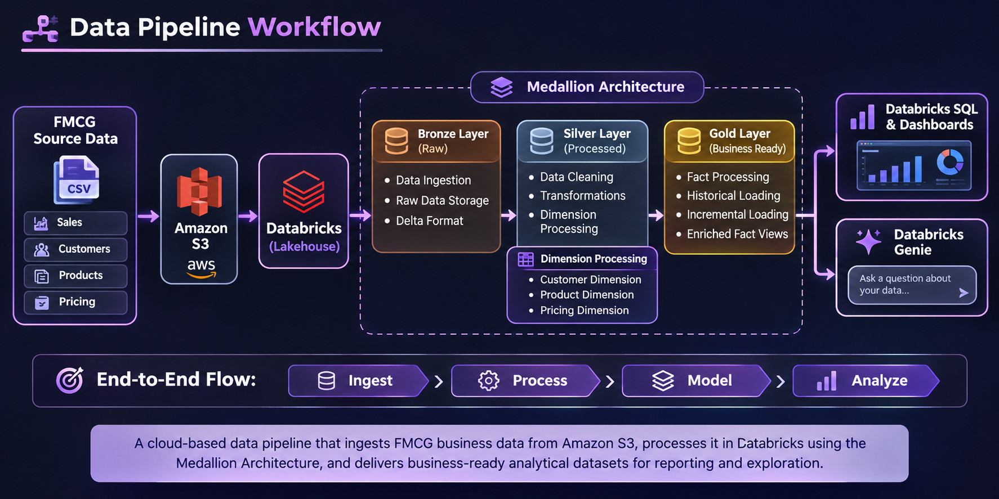
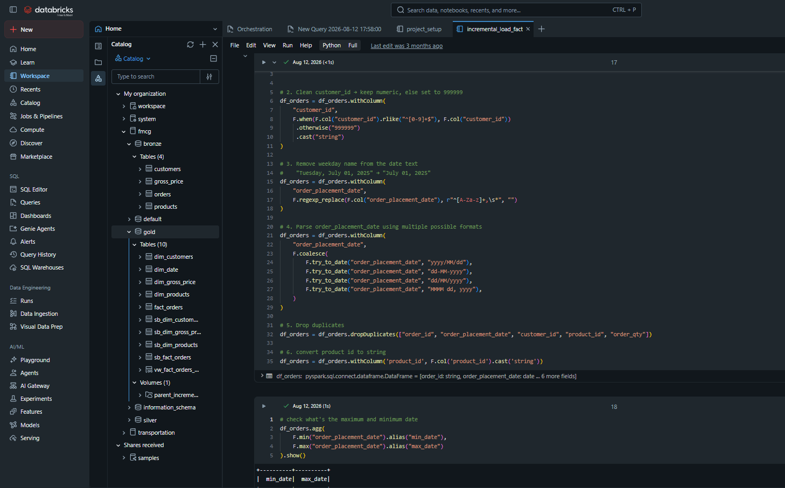
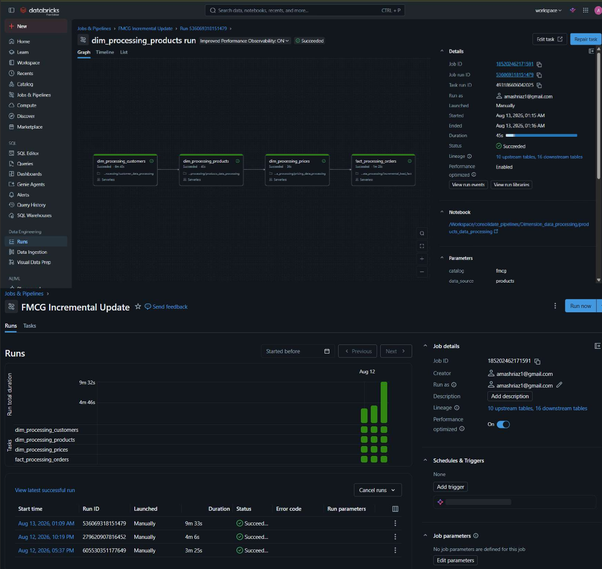
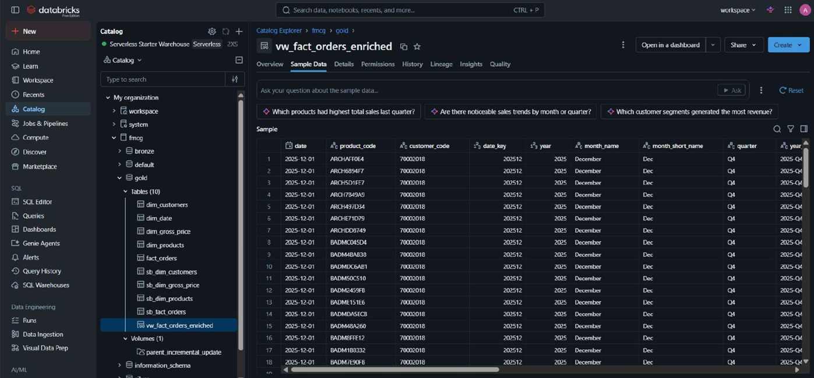
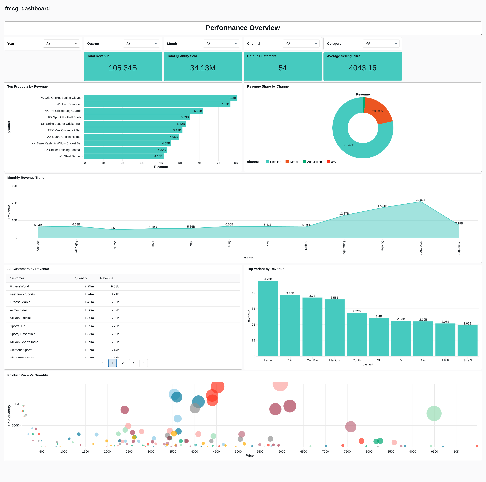

# FMCG Data Engineering Pipeline | AWS S3 & Databricks

<p align="center">
  <strong>End-to-End Data Engineering | Lakehouse Architecture | PySpark | Delta Lake</strong>
</p>

<p align="center">
  
  
  
  
  
</p>

## Project Overview

An end-to-end **FMCG Data Engineering Pipeline** built using **AWS S3 and Databricks** to process business data and develop a unified analytical data environment.

The project implements a Lakehouse architecture using the **Medallion Architecture (Bronze, Silver, and Gold)** to organize data ingestion, transformation, dimension processing, fact loading, and analytical data preparation.

The solution demonstrates how raw FMCG business data can be transformed into structured, business-ready datasets for reporting, analysis, and data exploration.

## Business Scenario

The project focuses on consolidating FMCG business data into a unified analytical environment.

It addresses key data engineering requirements such as:

- Organizing raw business data for downstream processing.
- Preparing and transforming customer, product, and pricing dimensions.
- Loading fact data through historical and incremental processing.
- Creating enriched analytical datasets for business reporting.
- Enabling data exploration through Databricks SQL, dashboards, and Genie.

## Architecture

The pipeline follows the **Medallion Architecture**, separating data processing into three logical layers.

| Layer | Purpose | Implementation |
|---|---|---|
| **Bronze** | Raw data ingestion and storage | Initial data ingestion into the lakehouse |
| **Silver** | Data cleaning and transformation | Dimension processing and structured data preparation |
| **Gold** | Business-ready analytical data | Fact processing, enriched views, and analytical datasets |


### Data Pipeline Workflow

The following architecture illustrates the complete FMCG data engineering workflow, from source data ingestion through Amazon S3 and Databricks to business-ready analytical datasets using the Medallion Architecture.

<p align="center">
  
</p>


## Technology Stack

| Category | Technologies |
|---|---|
| **Cloud Storage** | Amazon S3 |
| **Data Engineering Platform** | Databricks |
| **Big Data Processing** | Apache Spark, PySpark |
| **Programming Languages** | Python, SQL |
| **Data Storage Format** | Delta Lake |
| **Architecture** | Medallion Architecture |
| **Analytics & Exploration** | Databricks SQL, Databricks Dashboards, Genie |

## Project Structure

The repository is organized into logical directories to separate setup, dimension processing, fact processing, and SQL implementations.

```text
FMCG-Data-Engineering-Pipeline/
│
├── setup/
│   ├── catalog_setup
│   ├── utility_functions
│   └── date_dimension
│
├── Dimension_data_processing/
│   ├── customer_dimension
│   ├── product_dimension
│   └── pricing_dimension
│
├── Fact_data_processing/
│   ├── full_fact_load
│   └── incremental_fact_load
│
├── sql/
│   └── enriched_fact_views.sql
│
└── README.md
```

*Note: The structure above illustrates the logical organization. Notebook filenames and extensions may differ in the repository.*

## Key Engineering Implementations

### 1. Databricks Environment Setup
- Configured the Databricks catalog and schemas.
- Connected Databricks with Amazon S3 for data access.
- Created reusable utility functions for the processing workflow.
- Implemented date dimension creation.

### 2. Dimension Data Processing
- Processed customer dimension data.
- Implemented product dimension processing.
- Prepared pricing dimension data.
- Organized dimension datasets for downstream analytical processing.

### 3. Fact Data Processing
- Implemented full historical fact data loading.
- Developed incremental fact loading workflows.
- Organized fact processing to support analytical requirements.

### Code Implementation

The following screenshot shows the PySpark implementation used for data cleaning, handling customer IDs, date parsing, duplicate removal, and data preparation.

<p align="center">
  
</p>

### Pipeline Execution

The Databricks workflow coordinates customer, product, pricing, and fact processing tasks. The screenshot shows successful task execution and pipeline runs.

<p align="center">
  
</p>

### 4. SQL Views & Data Enrichment
- Developed SQL transformations for analytical data preparation.
- Created enriched fact views by combining fact and dimension data.
- Prepared business-ready datasets for downstream analysis.

### Enriched Fact Dataset

The enriched fact view combines fact and dimension attributes to create a structured dataset for downstream business analysis.

<p align="center">
  
</p>

### 5. Analytics & Data Exploration
- Explored FMCG business data using Databricks SQL.
- Developed Databricks dashboards for analytical reporting.
- Used Databricks Genie for natural-language data exploration.

### FMCG Analytics Dashboard

The final dashboard presents business metrics and visual insights, including revenue trends, product performance, customer analysis, and channel-wise revenue distribution.

<p align="center">
  
</p>

## Execution Workflow

The project notebooks can be explored in the following logical sequence:

1. **Environment Setup:** Configure the Databricks catalog, schemas, utility functions, and date dimension.
2. **Data Access:** Prepare access to the source data stored in Amazon S3.
3. **Dimension Processing:** Execute customer, product, and pricing dimension workflows.
4. **Historical Fact Loading:** Run the full fact loading workflow.
5. **Incremental Fact Loading:** Execute incremental fact processing.
6. **SQL Implementation:** Create enriched fact views using the SQL scripts.
7. **Analytics:** Explore the resulting datasets through Databricks SQL, dashboards, and Genie.

## How to Explore the Project

The Databricks notebooks are exported in Jupyter Notebook (`.ipynb`) format.

You can explore the implementation using:

- **GitHub:** Browse the notebooks and SQL scripts directly.
- **VS Code:** Open the exported notebooks and review their code.
- **Jupyter Notebook:** Open and inspect the notebook implementations.

To execute the complete workflow, you will need an appropriately configured Databricks environment and access to the required source data in Amazon S3.

## Key Concepts Demonstrated

- Cloud Data Engineering
- Amazon S3 Integration
- Lakehouse Architecture
- Medallion Architecture
- PySpark & Apache Spark
- Delta Lake
- Dimension and Fact Data Processing
- Historical and Incremental Data Loading
- SQL Views and Data Enrichment
- Analytical Data Preparation
- Databricks Analytics and Genie

## Future Enhancements

Potential extensions to the project include:

- Automating pipeline execution and scheduling.
- Adding data quality checks and validation.
- Implementing pipeline monitoring and error handling.
- Expanding incremental processing and recovery capabilities.
- Integrating additional business intelligence and reporting workflows.

## Author

**Amash Riaz**

Computer Science Graduate | Aspiring Data Engineer

- **GitHub:** [Amashriaz1103](https://github.com/Amashriaz1103)
- **LinkedIn:** [Amash Riaz](https://www.linkedin.com/in/amash-riaz/)


---

<p align="center">
  <strong>Built to demonstrate practical Data Engineering skills using AWS, Databricks, PySpark, and Lakehouse Architecture.</strong>
</p>
